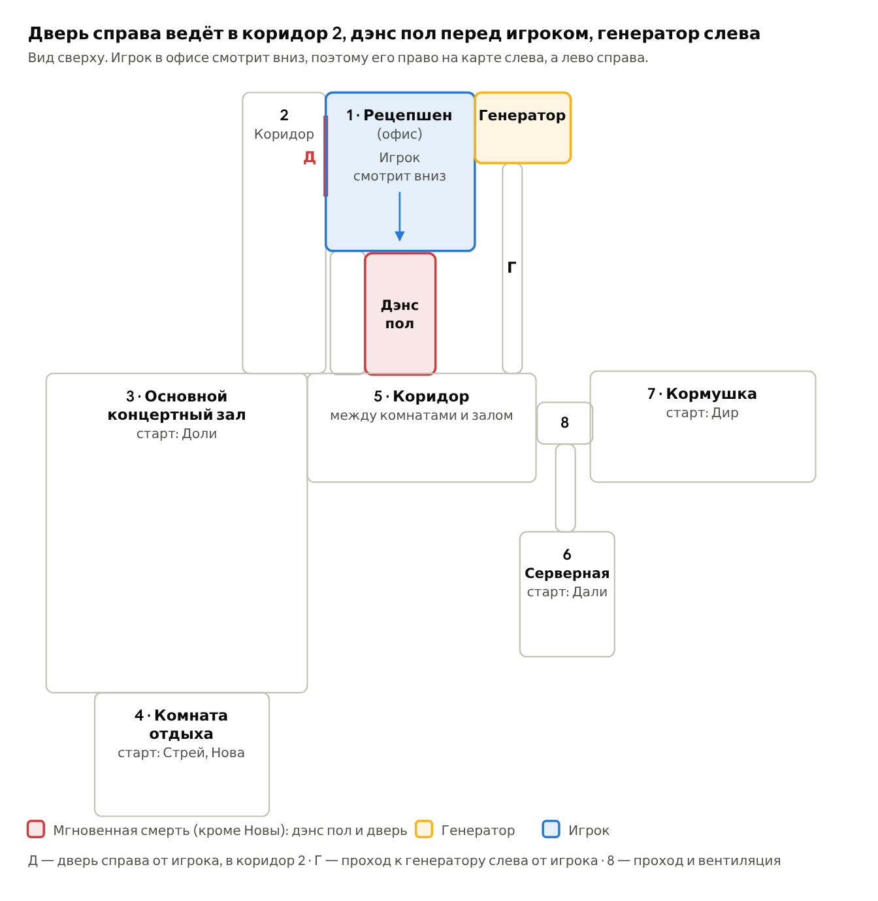

# Six to Seven Days at the Furry Night Club — геймдизайн

**SSDFNC** — это сокращение названия. Это живой документ: что решено, что в работе и что пока
открыто. Он основан на дизайн-документе «крнцепт док.docx» от 2026-10-16. Дальше правим
здесь.

## Аудитория

16+: любители пушистиков и фембоев, сами фурри и фанаты Five Nights at Freddy's.

## Концепт

FNAF-подобная игра на выживание. Игрок сидит в офисе клуба, следит за камерами и держит
оборону от пяти фурри. Движок Unity, 3D-модели в стиле Roblox.

- **Сеттинг.** Фурри-клуб: ночью он работает, днём пустует. Игрок сидит «на ресепшене», то
  есть в офисе (комната 1 на карте).
- **Изюминка.** Вместо дверей из FNAF игрок жонглирует четырьмя ресурсами: бензином, дэнс
  полом, кнопкой звука и дверью. Плюс отдельный режим дуэли (мог-батл) с Новой.
- **Тон** (хоррор, комедия или смесь) и общая структура игры пока не зафиксированы.

## Цикл смены

- **Смена дневная.** Клуб работает ночью, а днём закрыт, поэтому фурри и бродят по пустому
  зданию.
- **Победа:** дожить до конца таймера смены. Для последней ночи будут дополнительные условия.
- **Проигрыш:** контакт с убивающим фурри, смерть Дира от голода или проигранный мог-батл с
  Новой. После проигрыша смена начинается заново.
- **Длительность:** по дизайну **10 минут** (решено 2026-10-20). **Сейчас в игре 1.5 минуты**
  (2026-10-21), пока идёт разработка. В исходном документе
  предлагалось 6–8 минут для первой смены и рост по прогрессии.
- **Как устроено сейчас:** главное меню («Начать ночь» / «Выйти») → смена в офисе с часами в
  углу → время вышло → снова меню. Экранов победы и проигрыша пока нет.
- **Бензин:** обычно одна дозаправка за смену плюс запуски генератора, когда он заглох.

## Карта

Вид сверху. Игрок смотрит вниз по карте, поэтому его право на карте слева, а лево — справа.

| С точки зрения игрока | Что там | На карте |
|---|---|---|
| **справа** | дверь (Д) в коридор 2 | слева от офиса |
| **впереди** | коридор с дэнс полом | под офисом |
| **слева** | генератор, к нему проход Г из коридора 5 | справа от офиса |

### Комнаты и связи

| № | Комната | Соседи | Кто стартует |
|---|---|---|---|
| 1 | Ресепшен (офис) | 2 через дверь Д, дэнс пол, генератор | игрок |
| 2 | Коридор | 1 (дверь Д), 3 | — |
| 3 | Основной концертный зал | 2, 4, 5 | Доли |
| 4 | Комната отдыха | 3 | Стрей, Нова |
| 5 | Коридор между комнатами и залом | 3, дэнс пол, проход Г, 8 | — |
| 6 | Серверная | 8 | Дали |
| 7 | Кормушка | 8 | Дир |
| 8 | Проход и вентиляция | 5, 6, 7 | — |
| — | Дэнс пол (коридор перед офисом) | 5, офис | — |
| Г | Проход к генератору | 5, генератор | — |

Убить игрока можно только с двух направлений: через дверь справа и через коридор с дэнс полом.

### Маршруты

| Фурри | Маршрут |
|---|---|
| Дали | 6 → 8 → 5 → Г → генератор |
| Нова | 4 → 3 → 5 → дэнс пол |
| Стрей | 4 → 3 → 5 → дэнс пол **или** 4 → 3 → 2 → дверь |
| Доли | 3 → 2 → дверь **или** 3 → 5 → Г → генератор |
| Дир | 7, стоит на месте |

## Офис и инструменты

Игрок сидит за столом. Когда генератор не работает, отключается всё, кроме кнопки звука.

| Инструмент | Что делает | Ограничения | Без генератора |
|---|---|---|---|
| **Дэнс пол** | включается в коридоре перед офисом и отпугивает стеснительных фурри | работает, пока игрок держит кнопку, как фонарик во FNAF 2 | не работает |
| **Кнопка звука** | отпугивает тех, кто идёт к генератору | у некоторых фурри свои условия: Доли у двери от звука нападает | **работает** |
| **Дверь справа** | закрывается рычагом и блокирует вход из коридора 2 | энергию не тратит. Закрытой можно держать не дольше **20 с**: потом откроется сама и **заблокируется на 10 с** (решено 2026-10-21) | не работает, закрытая открывается |
| **Мониторы** | камеры по всем комнатам, слежение за дверью и проходом Г, досыпка корма Диру | ресурсов не тратят | не работают |

## Генератор и бензин

Генератор питает всё, кроме кнопки звука. У него три состояния, за которыми надо следить:
**здоровье**, **топливо** и **запуск** (работает или заглох).

| Параметр | Значение |
|---|---|
| Расход бензина | 150 ед. за смену |
| Бак генератора | 75 ед. (на старте полный) |
| Всего бензина у игрока | 220 ед., считая бак |
| Запас в канистрах (сверх бака) | 145 ед. |
| Остаток после одной дозаправки | 70 ед., это запас на потери |
| Слив бензина фурри | 10 ед. за 2 с (5 ед./с) |
| Здоровье | 100 HP, видно полоской |
| Урон от Дали | 20 HP за 2 с, генератор ломается за 10 с |
| Починка | **нет**, здоровье только уменьшается |

Из этих чисел следует:
- **Расход в секунду** = 150 / длительность смены. При нынешних 10 минутах это 0.25 ед./с.
  Полного бака (75) хватает ровно на полсмены, 5 минут.
- 70 ед. запаса на потери — это 14 секунд слива фурри.

**Глушение.** Если фурри уже начал глушить генератор, отпугивать поздно: глушение займёт
время, но генератор всё равно заглохнет. Потом его надо завести заново.

**Когда генератор не работает,** отключаются мониторы, дэнс пол и дверь. Работает только
кнопка звука. Мониторы при этом не только гаснут: Дира нельзя покормить, а цикл корма у
него около 30 с. Долгий простой генератора смертелен.

## Пять фурри

У каждого своя угроза и своя контра, поэтому игрок всё время выбирает, кому отвечать первым.

| Фурри | Старт | Куда идёт | Что делает | Контра |
|---|---|---|---|---|
| **Дир** | 7, кормушка | стоит на месте | ест корм. Корм кончился — звучит сигнал, через 3 с игрок умирает | через камеру досыпать корм, цикл около 30 с |
| **Стрей** | 4, комната отдыха | к двери (через 2) или к дэнс полу (через 5) | дойдя до офиса, нападает | включить дэнс пол или закрыть дверь. Закрыли — через время уходит, дверь на кулдаун 4 с |
| **Нова** | 4, комната отдыха | в коридор перед офисом, на дэнс пол | сама включает дэнс пол, отталкивает всех фурри вокруг на комнату назад, начинает мог-батл | выиграть мог-батл |
| **Дали** | 6, серверная | кратчайшим путём к генератору | глушит генератор или сливает бензин | кнопка звука |
| **Доли** | 3, концертный зал | к двери (через 2) или к генератору (через 5) | у двери нападает, у генератора ломает его. Звук с обеих сторон одинаковый | у генератора — кнопка звука. У двери — закрыть дверь, **звук нельзя**: нападёт сразу |

## Мог-батл с Новой

Начинается, когда Нова встаёт на дэнс пол и включает его.

- Пока идёт батл, остальные фурри замирают, а бензин не тратится.
- Пропустить или прервать батл нельзя, выключить дэнс пол нельзя.
- **Победа:** заполнить свою шкалу мога больше, чем Нова свою. Нова уходит и с каждой ночью
  становится опытнее. **Проигрыш** — смерть.
- Три вида скилл-чеков:
  - **Круг:** попасть стрелкой в зону на круге.
  - **Повороты:** повернуть влево или вправо в нужный момент.
  - **Полоска:** классический скилл-чек на полоске.

**Фазы атаки (решено 2026-10-23):** Появление (Нова разворачивает игрока к дэнс полу, анимация) →
5 скилл-чеков «кружок» → 5 «полосок» → 5 «в стороны» → Нова уходит или Смерть. Фаза пишется в правом
верхнем углу. Скилл-чеки не зашиты в код: под каждый трек своя раскладка, подгоняется руками
(json, [MOG_CHARTS.md](MOG_CHARTS.md)), потом для этого будет приложение.

**Как считается проигрыш (решено 2026-10-23):** вместо двух шкал — запас мога. Батл начинается с 3,
попал — +1 (не выше 4), промах — −1. На 0 Нова нападает сразу, не дожидаясь конца. Дожил до конца
хотя бы с 1 — выжил. Числа в `Balance.cs`. Открыто: попадание даёт +1 (так сделано) или сразу
поднимает до 4 (`MogLivesPerHit = 4`).

---

## Прототип и концепт

Три направления обзора в прототипе уже совпадают с офисом из концепта:

| Обзор | В прототипе (заглушка) | По концепту |
|---|---|---|
| A — влево | стена с **дверным проёмом**, за ним **генератор** (W — подойти, S — назад) | генератор и проход Г |
| центр | стол: монитор, кнопки дэнс пола и звука; впереди плитки дэнс пола, дальше зелёный шар | коридор с дэнс полом |
| D — вправо | стена с проёмом и **дверью** (рычаг и табличка справа от проёма), за ней синий коридор | дверь в коридор 2 |

## Статус механик

| Механика | Статус | Где в коде |
|---|---|---|
| Обзор на три стороны (A/D) | ✅ готово, прототип | `CameraLook` |
| Монитор: 8 камер (2–8, Г), кто в комнате — текстом | 🟡 текст вместо картинки | `CameraMonitor` |
| Генератор: бензин, HP-полоска, ручка перезапуска, кнопка «Залить» | ✅ первая версия | `Generator`, `GeneratorHandle`, `GeneratorPanel` |
| Отключение монитора без генератора | ✅ готово | `CameraMonitor` |
| Слив бензина, глушение и урон от фурри | ⬜ методы есть (`Drain`, `Stall`, `Damage`), фурри нет | `Generator` |
| Отпугивающие факторы: режимы «разово», «пока держишь», «вкл/выкл» | ✅ готово | `Deterrent`, `PressControl` |
| Кнопка звука (разово, без генератора) | ✅ готово, гудок из кода | `SoundSignal` |
| Дверь справа (рычаг вкл/выкл, 20 с максимум, блок 10 с, без питания открывается) | ✅ готово | `Door` |
| Дэнс пол (пока держишь, нужен генератор) | ✅ готово | `DanceFloor` |
| Реакция фурри на отпугивание | ✅ готово | `SSDFNC.Core` |
| Главное меню: «Начать ночь», «Выйти» | ✅ готово | `MainMenu` |
| Таймер смены (10 мин), часы, возврат в меню | ✅ готово | `ShiftTimer` |
| Экраны победы и проигрыша, рестарт смены | ⬜ нет | — |
| ИИ фурри как во FNAF: уровень 0–20, кубик, рост за смену, маршруты по карте | ✅ готово | `Furry`, `Night` |
| Сложность Easy / Normal / Hard / Custom (в коде) | ✅ готово | `Difficulty` |
| Настройка ночи в меню (вкладка): уровни фурри до начала ночи | ✅ готово | `NightSettingsTab` |
| Дир и кормление через камеру 7 (держать 1.5 с) | ✅ готово | `DirAI`, `CameraMonitor` |
| Стрей, Дали, Доли | ✅ готово, вместо моделей капсулы | `Furries.cs`, `FurryAvatar` |
| Нова и мог-батл | 🟡 фазы и раскладки под музыку готовы; кружок и «в стороны» пока работают как полоска | `NovaAI`, `MogBattle`, `MogTimeline` |
| Приложение настройки скилл-чеков | ⬜ нет, план в `MOG_CHARTS.md` | — |
| Смерть: экран и смена заново | ✅ готово, без джампскеров | `NightDirector` |
| Тесты правил и симуляция баланса | ✅ 47 тестов, отчёт по балансу | `FurryTests`, `MogTests`, `NightSimulator` |
| Настоящие камеры (картинка с комнат) | ⬜ нет | — |
| Модели в стиле Roblox | ⬜ нет | — |

## Что в концепте пока неясно

Это не ошибки, а места, которые надо решить к своей механике.

**Генератор:**
1. ~~Как игрок доливает бензин и заводит генератор?~~ **Решено 2026-10-20:** генератор слева,
   заводится ручкой стартера (клик — рывок, заводится с первого раза), бензин заливается кнопкой
   «Залить» (держать, 15 ед./с). Открыто: нужно ли несколько рывков или шанс не завестись.
2. ~~Кто сливает бензин и кто глушит?~~ **Решено 2026-10-22:** Дали (идёт только к генератору)
   глушит или сливает бензин (50 на 50, начатое звук не остановит). Доли у генератора ломает
   (20 HP за 2 с), пока его не спугнут звуком; через 10 с генератор сломан. У Доли один и тот же звук
   у двери и у генератора; у слива бензина — свой звук, только пока сливают.
   К генератору вдвоём не ходят: Дали пошла — Доли идёт к двери; Доли у генератора (или идёт туда) —
   Дали ждёт в проходе 8.
3. ~~Глохнет ли генератор сам, когда кончился бензин?~~ Сделано так: да, глохнет.
4. ~~Что при 0 HP?~~ Сделано так: сломан до конца смены, ручка не помогает. Подтвердить.
5. **Тратят ли бензин дэнс пол и мониторы?** По таблице инструментов нет, значит расход
   постоянный. Подтвердить.

**Позже:**
6. Сколько камер? В прототипе 6 кнопок, а комнат 8 плюс дверь и проход Г.
7. ~~Через какое время дверь открывается сама?~~ **Решено:** через 20 с, потом блок 10 с. Открыто:
   через сколько Стрей уходит от закрытой двери и нужен ли отдельный кулдаун 4 с после его ухода.
   Нужна ли задержка между звуковыми сигналами (сейчас можно жать без ограничений)?
8. Кто именно «стеснительный» и боится дэнс пола: только Стрей или ещё кто-то? Сейчас только Стрей.
10. **Предложение по балансу (сделано, можно выключить):** закрытая дверь глушит кнопку звука, и Доли
    у закрытой двери её не слышит (`Balance.DoorMufflesSound`). Без этого ловушка убивала 18–28%
    ночей. Почему — в [FURRY_AI.md](FURRY_AI.md), раздел 6.
11. Нова после проигранного ею батла 180 с сидит дома (`NovaRestAfterBattle`) — тоже для баланса.
9. Смена дневная, но в тексте встречаются «ночь» и «последняя ночь». Кнопка в меню сейчас
   называется «Начать ночь». Оставляем «ночь» везде?
